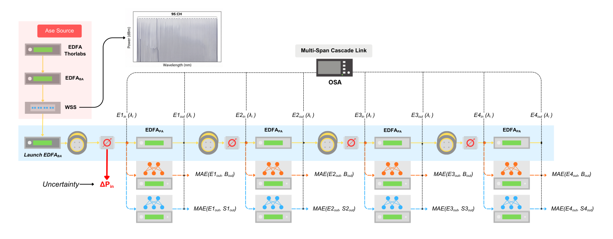
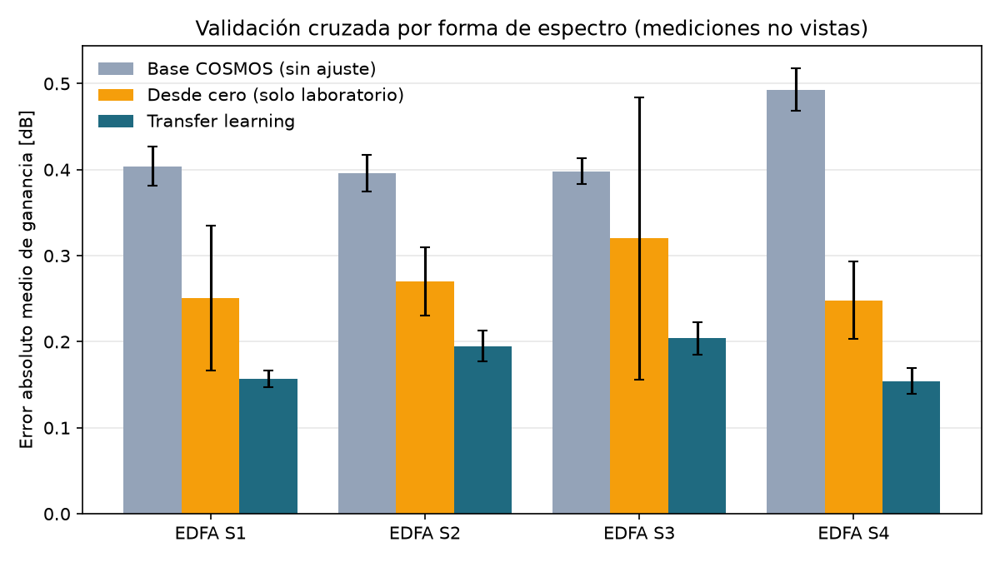
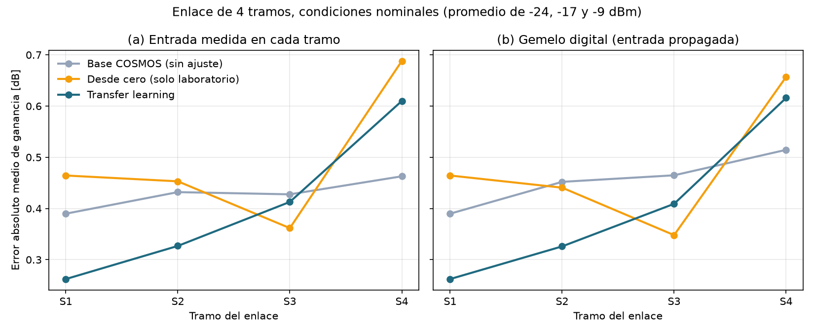
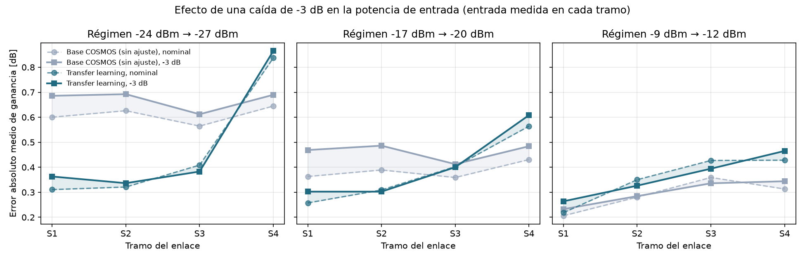

# Predicción de ganancia de amplificadores ópticos (EDFA) con transfer learning

Red neuronal en **PyTorch** que predice la ganancia de cada uno de los 95 canales de un
amplificador óptico EDFA. Se preentrena con un dataset público (COSMOS, 126.320 mediciones)
y se especializa con **transfer learning** en 4 amplificadores reales medidos en laboratorio.
Después se prueba en un enlace real de 4 tramos (200 km), en condiciones nominales y con una
caída de potencia de −3 dB que emula la incertidumbre de una red en operación.

Proyecto basado en mi tesis de Magíster en Ciencias de la Ingeniería (Universidad de Concepción,
2026), *"Impacto de la incertidumbre en la estimación de la calidad en una línea de transmisión óptica"*.

> **English summary.** PyTorch MLP that predicts the per-channel gain of an EDFA, pretrained on the public
> COSMOS dataset and fine-tuned (two-phase transfer learning) on 4 lab-measured amplifiers. With
> cross-validation grouped by input-spectrum shape, transfer learning cuts the gain error by 58 % (0.42 → 0.18 dB).
> On a real 4-span, 200 km link the picture is a trade-off: transfer learning wins on the first spans, but its
> error grows along the cascade (0.26 → 0.61 dB) while the generic model stays flatter (0.39 → 0.46 dB).

## El problema

Un EDFA amplifica todos los canales de una fibra a la vez, pero no con la misma ganancia: la
ganancia cambia con la longitud de onda (*gain ripple*), la potencia de entrada y la cantidad de
canales encendidos, y cada equipo físico se comporta un poco distinto. Para estimar la calidad de
transmisión de un enlace (QoT) sin medirlo, hace falta predecir esa ganancia en cada amplificador.

Un modelo entrenado con miles de mediciones de otros equipos (COSMOS) generaliza bien, pero no
conoce nuestros amplificadores. Medir lo suficiente para entrenar desde cero es caro. El transfer
learning parte del modelo general y lo ajusta con pocas mediciones propias. La pregunta es si ese
ajuste local se mantiene cuando los amplificadores trabajan encadenados y con potencias inciertas.

## Montaje experimental



Una fuente ASE ecualizada con un WSS genera 95 canales en banda C (grilla de 50 GHz). Un amplificador
de lanzamiento alimenta el enlace de 4 tramos de 50 km (fibra SMF-28 + atenuador variable), con
un EDFA bajo prueba (S1 a S4) al final de cada tramo, todos en control automático de ganancia a 20 dB.
Un analizador de espectro óptico (OSA) captura la entrada y salida de cada EDFA. La incertidumbre se
emula bajando 3 dB la potencia solo antes de S1, sin tocar el resto del enlace.

## Datos

| Conjunto | Qué contiene | Uso |
|---|---|---|
| COSMOS (público) | 126.320 mediciones de preamplificadores comerciales ([COSMOS EDFA Dataset](https://wiki.cosmos-lab.org/wiki/Datasets)) | Preentrenar el modelo base |
| `datos/laboratorio/dataset_S1..S4.csv` | 270 mediciones por EDFA aislado: 2 cargas (95 y 48 canales) × 5 perfiles de espectro (plano, inclinación positiva y negativa, U, U invertida) × 9 potencias × 3 ganancias (21, 24 y 27 dB) | Especializar y validar |
| `datos/laboratorio/enlace_4_tramos.csv` | El enlace completo, 95 canales, a 9 potencias de entrada (incluye los 3 regímenes nominales y sus versiones con −3 dB) | Prueba final; nunca se usa para entrenar |
| `datos/osa_ejemplo/` | Capturas originales del OSA (entrada y salida de un EDFA) | Ejemplo del procesamiento |

## Método

1. **Procesamiento de las capturas del OSA** (`edfa/osa.py`): lectura del archivo del equipo,
   detección automática de los 95 canales y cálculo de la ganancia por canal.
2. **Modelo base** (`edfa/base.py`): perceptrón multicapa (193 entradas → 95 ganancias, 128 mil
   parámetros, arquitectura de Wang et al.) entrenado con COSMOS. Las entradas son el espectro de
   entrada, los canales encendidos, la ganancia objetivo y las potencias totales de entrada y salida.
3. **Especialista por EDFA** (`edfa/entrenamiento.py`), con transfer learning en dos fases:
   - Fase 1: se congelan las capas del modelo base y se reentrena solo la última.
   - Fase 2: se ajusta la red completa con una tasa de aprendizaje baja.

   Como comparación se entrena el mismo modelo desde cero, solo con datos del laboratorio.
4. **Validación cruzada sin fugas** (`edfa/validacion.py`).
5. **Evaluación en el enlace** (`edfa/enlace.py`), de dos formas:
   - *Entrada medida*: cada modelo recibe el espectro medido a la entrada de su EDFA, que ya trae
     ruido ASE e inclinación acumulados de los tramos anteriores.
   - *Gemelo digital*: cada tramo recibe el espectro que predijo el anterior, así que además se
     acumulan los errores de predicción.

El error siempre se mide solo en los canales encendidos. Cada resultado con entrenamiento es el
promedio de 3 semillas.

## Resultados

### 1. EDFA aislado: validación cruzada

¿Qué tan bien predice cada modelo, en su propio amplificador, espectros que no vio al entrenar?
Error absoluto medio (dB), 5 pliegues × 3 semillas:

| EDFA | Base COSMOS | Desde cero | Transfer learning |
|---|---|---|---|
| S1 | 0,404 | 0,251 ± 0,084 | **0,157 ± 0,010** |
| S2 | 0,396 | 0,270 ± 0,040 | **0,195 ± 0,018** |
| S3 | 0,398 | 0,320 ± 0,164 | **0,204 ± 0,019** |
| S4 | 0,493 | 0,248 ± 0,045 | **0,154 ± 0,015** |
| **Promedio** | 0,423 | 0,272 | **0,178** |



Con el amplificador aislado, el transfer learning reduce el error un **58 %** frente al modelo
general y un **35 %** frente a entrenar desde cero, y varía entre 2 y 9 veces menos entre pliegues
y semillas.

### 2. Enlace de 4 tramos en condiciones nominales

Error absoluto medio (dB), promedio de los regímenes −24, −17 y −9 dBm:

| Tramo | Base (medida) | Transfer (medida) | Base (gemelo) | Transfer (gemelo) |
|---|---|---|---|---|
| S1 | 0,390 | **0,262** | 0,390 | **0,262** |
| S2 | 0,432 | **0,327** | 0,452 | **0,326** |
| S3 | 0,428 | **0,413** | 0,465 | **0,409** |
| S4 | **0,463** | 0,610 | **0,514** | 0,616 |
| **Promedio** | 0,428 | **0,403** | 0,455 | **0,403** |



- En el primer tramo el especialista tiene un 33 % menos de error que el modelo general.
- **Pero su error crece a lo largo del enlace** (+0,35 dB de S1 a S4), mientras que el del modelo
  general crece poco (+0,07 dB con entrada medida). Los espectros que llegan a los tramos finales,
  deformados por el ruido ASE y la inclinación acumulados, son distintos a los que el especialista
  vio en el laboratorio; el modelo general, entrenado con mucha más variedad, se degrada menos.
- Entrenar desde cero vuelve a ser inestable: su error promedio varía entre ±0,08 y ±0,10 dB entre
  semillas, frente a ±0,01 dB del transfer learning (tabla completa en `resultados/enlace.csv`).

### 3. Incertidumbre: caída de −3 dB en la potencia de entrada



Aumento del error por la caída de −3 dB en el primer tramo (dB, entrada medida):

| Régimen | Base COSMOS | Transfer learning |
|---|---|---|
| −24 → −27 dBm | 0,085 | **0,052** |
| −17 → −20 dBm | 0,106 | **0,045** |
| −9 → −12 dBm | **0,026** | 0,045 |

- A potencias bajas y medias, el especialista absorbe mejor la caída de potencia en el primer tramo.
- La ventaja depende del régimen: a −24 dBm el especialista tiene la mitad del error del modelo
  general en S1 (0,31 frente a 0,60 dB), mientras que a −9 dBm el modelo general es igual o mejor.
- En todos los regímenes, el último tramo (S4) sigue siendo el punto débil del especialista.

**Conclusión:** el ajuste local mejora la precisión donde los espectros se parecen a los del
laboratorio (primeros tramos, potencias bajas y medias), pero el modelo general es más robusto a la
acumulación de efectos a lo largo del enlace. Un gemelo digital confiable necesitaría combinar ambos,
por ejemplo entrenando los especialistas también con espectros medidos dentro del enlace.

### Por qué importa cómo se separan los datos

En los datos del laboratorio cada entrada se mide 3 veces (una por ajuste de ganancia) y cada
perfil de espectro se repite a 9 potencias. Si entrenamiento y prueba se separan **al azar**, la
prueba contiene mediciones casi idénticas a las del entrenamiento (fuga de datos). Aquí se dejan
fuera **perfiles de espectro completos**, y como control se repitió la separación al azar
(esquema `al_azar` en `resultados/validacion_cruzada.csv`): con transfer learning daba entre 0,013
y 0,017 dB menos de error. La fuga existía, pero inflaba poco el resultado.

## Limitaciones

- **Ganancia objetivo.** El modelo recibe la ganancia media *medida* de cada tramo (así está
  construido el dataset de entrenamiento), no los 20 dB comandados. Con el valor comandado, el error
  en el enlace sube a ~1,1 dB en los tres modelos (`python -m edfa.enlace --comando-20db`). En un
  enlace real, la ganancia media se puede estimar con los monitores de potencia total del amplificador.
- **Tramo S3.** En las capturas del OSA, la entrada de S3 aparece ~3 dB más alta y su ganancia
  ~2,5 dB más baja que en los otros tramos, sin una causa identificada. Los resultados usan los datos
  tal como se midieron. En la tesis se ajustó la ganancia de S3 al promedio de S2; con ese ajuste
  (`datos.cargar_enlace(ajuste_s3=True)`) el error promedio cambia menos de 0,01 dB.
- Pocos datos propios: 270 mediciones por amplificador, de un solo laboratorio.
- La tesis incluyó además modelos que consideran la posición del EDFA en la línea y una búsqueda
  de hiperparámetros con Optuna; no están en esta versión del repositorio.

## Cómo ejecutarlo

```bash
python -m venv .venv
.venv\Scripts\activate            # Windows  (Linux/Mac: source .venv/bin/activate)
pip install -r requirements.txt

python -m pytest                  # pruebas (~5 s)
python -m edfa.enlace             # enlace: nominal e incertidumbre (~3 min en CPU)
python -m edfa.validacion         # validación cruzada (~15 min en CPU; --rapido para 1 semilla)
```

Los resultados (tablas CSV y figuras) quedan en `resultados/`. El modelo base ya entrenado está en
`modelos/base_cosmos.pth`; para reentrenarlo se necesita el CSV de COSMOS (`python -m edfa.base --csv ...`).

## Estructura

```
edfa/
  osa.py            lectura de capturas del OSA y extracción por canal
  datos.py          carga de mediciones y armado de entradas del modelo
  modelo.py         red neuronal (PyTorch)
  base.py           preentrenamiento con COSMOS
  entrenamiento.py  entrenamiento desde cero y transfer learning en 2 fases
  validacion.py     validación cruzada por perfil de espectro
  enlace.py         evaluación en el enlace de 4 tramos (nominal e incertidumbre)
datos/              mediciones del laboratorio y capturas de ejemplo del OSA
docs/               figura del montaje experimental
modelos/            modelo base y especialistas finales
resultados/         tablas y figuras generadas
tests/              pruebas automáticas (pytest)
```

## Referencias

- Z. Wang, D. C. Kilper y T. Chen, "Open EDFA gain spectrum dataset and its applications in
  data-driven EDFA gain modeling", *J. Opt. Commun. Netw.*, vol. 15, pp. 588–599, 2023.
  Dataset: https://wiki.cosmos-lab.org/wiki/Datasets. La arquitectura del modelo base sigue este trabajo.
- L. Muñoz Rosel, C. Melo y G. Saavedra, "Parametric sensitivity analysis of EDFA gain ripple using
  a data-driven machine learning model", *IMOC 2025*, pp. 109–113 (Best Student Paper Award).

## Autor

**Leonardo Muñoz Rosel**, Ingeniero Civil en Telecomunicaciones y Magíster en Ciencias de la
Ingeniería (Universidad de Concepción). Mediciones realizadas en el laboratorio de la Universidad de
Concepción, en el marco del proyecto FONDECYT N° 123826. [LinkedIn](https://www.linkedin.com/in/leomr-ict/) ·
[Portafolio](https://leomr-ict.github.io)
